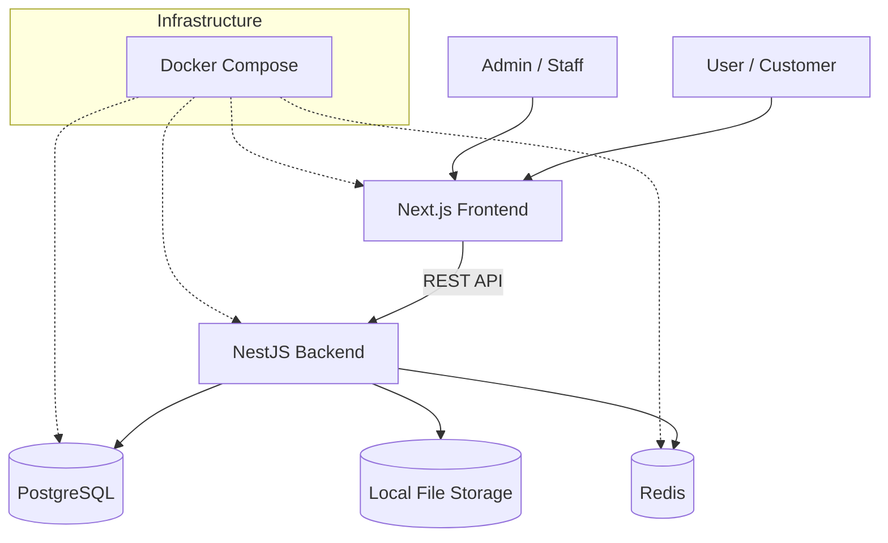

# SARVAA Fresh

An operations platform for digitizing a real-world fruit and vegetable business.

SARVAA Fresh is a full-stack web application built to replace manual operational workflows with structured, reliable software. It handles product catalog management, inventory tracking, customer orders, cart and checkout flows, and administrative operations—all backed by a transactional database layer designed for consistency and auditability.

The project was created to solve an actual business problem. The goal is not to build another grocery storefront, but to provide the operational backbone for a family-owned produce business: stock control, order processing, delivery coordination, and administrative visibility.

---

## Why SARVAA?

Fresh produce businesses operate on thin margins and tight inventory cycles. Common operational challenges include:

- **Manual inventory tracking** across multiple product variants and units
- **Stock uncertainty** when orders come in through calls or messages
- **No centralized product catalog** with consistent pricing and availability
- **Fragmented order records** spread across chats, notebooks, or spreadsheets
- **Delayed status updates** between customers and fulfillment staff
- **Limited visibility** into daily operations, stock levels, and revenue

SARVAA Fresh centralizes these workflows into a single system with role-based access for customers and administrators.

---

## What It Does

### Customer-Facing

- **Product browsing** with category filtering, search, and variant selection
- **Shopping cart** with live stock validation and subtotal calculation
- **Checkout** with address selection and order placement
- **Order history** with detailed status timelines
- **Account management** with profile and saved addresses

### Cart & Checkout

- Add, update, and remove cart items
- Automatic subtotal recalculation
- Stock availability checks before adding to cart
- Cart cleared atomically upon order placement

### Orders

- Order creation with unique order numbers
- Status lifecycle: `PENDING` → `CONFIRMED` → `PACKING` → `OUT_FOR_DELIVERY` → `DELIVERED`
- Customer-initiated cancellation (before dispatch)
- Order status history with remarks
- Snapshot of product names and prices at time of order

### Inventory

- Per-variant inventory tracking (`availableStock`, `reservedStock`)
- Low-stock thresholds
- Transaction audit trail with typed operations:
  - `PURCHASE`, `SALE`, `ADJUSTMENT`, `RESERVE`, `RELEASE`, `DAMAGE`, `RETURN`
- Stock reservation during order creation to prevent overselling
- Automatic stock release on cancellation
- Never allows stock to drop below zero

### Administration

- Admin authentication with role-based access (`SUPER_ADMIN`, `MANAGER`, `STAFF`)
- Order management: list, view details, update status, cancel
- Order statistics dashboard
- Inventory lookup and manual stock adjustments
- Product and category management
- Settings management (business info, delivery, payment, contact)

### Authentication & Security

- JWT-based authentication for customers and admins
- Separate token strategies for user and admin contexts
- Rate limiting on login and registration endpoints
- Password hashing with bcrypt
- Role-based route guards
- Helmet security headers
- CORS configuration
- Request validation with class-validator

---

## Current Status

### Implemented

- Customer registration, login, and profile
- Product catalog with categories and variants
- Image support for products
- Shopping cart with stock validation
- Order creation with transactional inventory reservation
- Order lifecycle management and status history
- Payment recording (COD and UPI) with admin verification
- Inventory tracking with full transaction audit trail
- Address management
- Admin authentication and authorization
- Admin order management and statistics
- Settings system
- File upload infrastructure
- Health check endpoints
- API documentation via Swagger

### In Progress

- Admin dashboard UI
- Additional administrative workflows

### Planned

- Delivery partner assignment and tracking
- Advanced reporting and analytics
- Customer notifications
- Returns and refund workflows
- Operational automation helpers
- Potential AI-assisted features (inventory recommendations, support automation, reporting)

---

## Engineering Highlights

### Transactional Order Creation

Order creation, inventory reservation, and cart clearing happen inside a single Prisma transaction. If any step fails—insufficient stock, missing address, validation error—the entire operation rolls back. This prevents orphaned orders, double reservations, or stock mismatches.

### Inventory Reservation Model

Inventory is split into `availableStock` and `reservedStock`. When a customer places an order, stock moves from available to reserved. When an order is cancelled or delivered, stock is released or confirmed accordingly. This separation prevents overselling while orders are in progress.

### Oversell Protection

Stock updates use conditional database constraints (`availableStock: { gte: quantity }`) inside transactions. If two orders target the same variant simultaneously, the database enforces the limit rather than relying on application-level checks alone.

### Dual Authentication Contexts

The backend maintains separate authentication flows for customers and admins. Each has its own JWT strategy, guard, and token validation. This isolates customer-facing operations from administrative actions.

### Role-Based Access Control

Admin roles (`SUPER_ADMIN`, `MANAGER`, `STAFF`) are enforced at the controller and service layers. Admin endpoints are protected by a dedicated guard that validates admin tokens and role claims.

### Rate Limiting

Authentication endpoints use `@nestjs/throttler` to limit login attempts. This reduces brute-force exposure without affecting authenticated traffic.

### Soft Deletes

Most models support `deletedAt` timestamps. Data is preserved for audit purposes while being excluded from normal queries.

### Audit Trail

Inventory changes create immutable `InventoryTransaction` records with before/after stock levels, type, reason, and reference to the triggering entity (order, adjustment, etc.).

### Docker-Based Deployment

Production runs via Docker Compose with defined health checks, restart policies, volume persistence, and environment-based configuration. The backend runs Prisma production migrations automatically on startup.

### API Documentation

NestJS Swagger integration provides auto-generated API documentation for client development and integration testing.

---

## Architecture



**Frontend** — Next.js application serving the customer storefront and admin interface. Communicates with the backend via REST APIs.

**Backend** — NestJS API with modular architecture. Handles business logic, validation, authentication, authorization, and data persistence.

**PostgreSQL** — Primary data store. Prisma ORM manages schema, migrations, and queries.

**Redis** — Used for caching and session management.

**File Storage** — Local volume-mounted storage for uploaded images and payment proofs.

**Infrastructure** — Docker Compose orchestrates services with health checks, restart policies, and environment configuration.

---

## Technology Stack

| Layer | Technology |
|---|---|
| Frontend | Next.js 16, React 19, Tailwind CSS 4 |
| Backend | NestJS 10, TypeScript 5 |
| Database | PostgreSQL 16 |
| ORM | Prisma 5 |
| Cache | Redis 7 |
| Authentication | JWT (Passport.js), bcrypt |
| API Documentation | Swagger / OpenAPI |
| Containerization | Docker, Docker Compose |
| Infrastructure | Alpine-based images, health checks |

---

## Project Structure

```
sarvaa-fresh/
├── backend/
│   ├── prisma/
│   │   ├── schema.prisma
│   │   └── migrations/
│   └── src/
│       ├── auth/              # Customer authentication
│       ├── admin-auth/        # Admin authentication
│       ├── users/             # Customer management
│       ├── products/          # Products and variants
│       ├── categories/        # Product categories
│       ├── product-images/    # Product image management
│       ├── cart/              # Shopping cart
│       ├── orders/            # Customer orders
│       ├── inventory/         # Stock management and transactions
│       ├── payments/          # Payment records and verification
│       ├── addresses/         # Customer addresses
│       ├── settings/          # Application settings
│       ├── admin-orders/      # Admin order operations
│       ├── admin-dashboard/   # Admin statistics
│       ├── storage/           # File upload handling
│       ├── health/            # Health checks
│       ├── common/            # Guards, decorators, filters
│       └── config/            # Environment configuration
├── frontend/
│   ├── app/
│   │   ├── products/          # Product listing and detail
│   │   ├── cart/              # Cart page
│   │   ├── checkout/          # Checkout flow
│   │   ├── orders/            # Order history and detail
│   │   ├── auth/              # Login and registration
│   │   ├── account/           # User account
│   │   └── admin/             # Admin interface
│   └── components/            # Reusable UI components
├── infrastructure/
│   ├── docker-compose.yml
│   ├── docker-compose.production.yml
│   └── init-scripts/
├── docs/
│   ├── API_SPEC.MD
│   ├── ARCHITECTURE.md
│   ├── DATABASE.md
│   ├── PRD.md
│   └── WIREFRAMES.md
├── .env.example
├── .env.production.example
└── README.md
```

---

## Development

### Prerequisites

- Node.js 20+
- PostgreSQL 16
- Redis 7
- Docker and Docker Compose (optional)

### Local Setup

```sh
# Install backend dependencies
cd backend && npm install

# Install frontend dependencies
cd frontend && npm install

# Configure environment
cp backend/.env.example backend/.env
cp .env.production.example .env.production

# Run database migrations
cd backend && npx prisma migrate dev

# Start backend (development)
cd backend && npm run start:dev

# Start frontend (development)
cd frontend && npm run dev
```

### Docker

```sh
# Start production stack
docker compose -f infrastructure/docker-compose.production.yml --env-file .env.production up --build

# Stop
docker compose -f infrastructure/docker-compose.production.yml --env-file .env.production down
```

---

## Future Directions

The architecture is designed to support future automation and operational intelligence. Potential directions include:

- Inventory monitoring with low-stock alerts
- Reorder recommendations based on sales patterns
- Customer support automation
- Operational reporting and analytics
- Fulfillment assistance and routing
- Natural-language operational interfaces

These represent potential future directions and are not currently implemented.